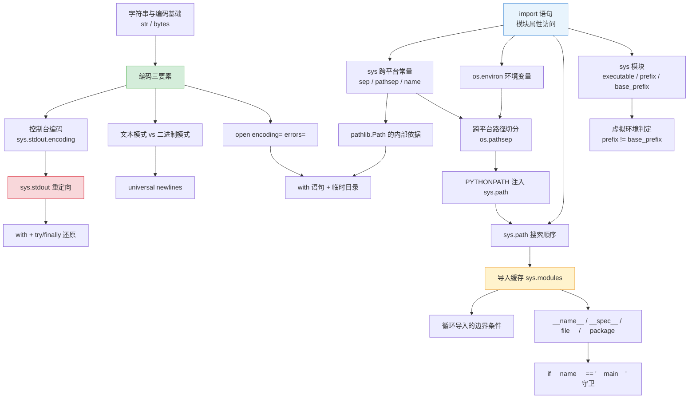

# 语法解析 · 01_env（环境与工具链）

> 本文档配套目录 `python-learning/code/01_env/` 下的三个演示文件。
> 所有代码片段均摘自真实源码，标注格式为 `文件名:行号`。
> 阅读建议：先跑一遍源码看输出，再对照本文逐节拆解。

---

## 学习目标

完成本章后，应当能够：

1. 说清 `sys.executable` / `sys.prefix` / `sys.base_prefix` / `sys.path` 各自的语义，
   并能用它们判断"当前是否运行在虚拟环境中"。
2. 解释 `sys.path` 的元素顺序，并说明它如何决定 `import` 的成败，
   以及"标准库被同目录同名文件劫持"这类事故的成因。
3. 熟练使用 `os.environ` 的 `get` / `in` / `defaultdict` 三种读法，
   并用 `os.pathsep` 切分 `PATH`，写出跨平台的路径处理代码。
4. 解释 Windows 中文环境下 `print 中文正常但 print emoji 崩溃` 的根因，
   并能区分"源码编码 / 声明编码 / I/O 编码"三要素。
5. 正确使用 `pathlib.Path` 的 `/` 重载、`as_posix()`、`resolve()`、`with_suffix()`，
   并说清它与 `os.path.join` 的差异。
6. 独立写出 `with` 语句（`__enter__` / `__exit__` 的触发时机与异常传播），
   并用 `tempfile.TemporaryDirectory` 管理临时目录。
7. 解释 `errors=` 的三种策略（`strict` / `ignore` / `replace`）的取舍，
   并说清 `strict` 作为默认值的 fail-fast 设计动机。
8. 区分文本模式与二进制模式在换行符处理上的差异，掌握 universal newlines。
9. 理解 `sys.stdout` 可被替换的原理，并能安全地做输出重定向与恢复。
10. 掌握 `if __name__ == "__main__":` 的取值规则、导入缓存机制，
    以及"模块顶层不应有副作用"的工程约束。

---

## 本模块代码清单

| 文件名 | 一句话说明 |
|---|---|
| `01_venv_demo.py` | 解释器与虚拟环境的"体检报告"：打印 `sys.executable`/`prefix`/`base_prefix`/`sys.path`/`os.environ` 与跨平台路径常量，只检测不创建。 |
| `02_path_and_encoding.py` | 把路径与编码放在一起：`pathlib` 用法、Windows 路径三个陷阱、编码三要素、`errors=` 容错、换行符归一化、`sys.stdout` 重定向。 |
| `03_script_vs_module.py` | 讲清 `__name__` 的取值规则、`__main__` 守卫、导入缓存（`sys.modules`）、`__package__` 与相对导入，并用子进程实测"被导入"时的行为。 |

---

## 1. `import` 语句与模块对象的属性访问

### 语法规则

```
import 模块名
import 模块名 as 别名
import 包.子模块
import a, b, c              # 一行导入多个

模块名.属性名               # 点号属性访问
```

BNF 风格描述：

```
import_stmt  ::= 'import' dotted_name (',' dotted_name)* 
dotted_name  ::= NAME ('.' NAME)*
```

关键约束：

- `import` 是**语句**（statement），不是表达式，不能出现在 `x = import os` 这样的位置。
- 被导入的名字绑定到**当前命名空间**：模块级写在模块全局，函数内写在函数局部。
- `import a.b` 绑定的是名字 `a`，不是 `a.b`；要用 `a.b.属性` 需 `import a.b` 或 `from a import b`。

### 代码实例

```python
import os
import sys
```
（`01_venv_demo.py:29-30`）

```python
print(f"    executable   = {sys.executable}")
```
（`01_venv_demo.py:62`）

```python
import os
import os.path
import sys
import tempfile
from pathlib import Path
```
（`02_path_and_encoding.py:36-41`）

### 执行过程逐步推演

以 `01_venv_demo.py` 的前几行为例，解释器逐字节做以下事情：

| 行号 | 代码 | 变量 / 内存状态变化 |
|---|---|---|
| 29 | `import os` | ① 查 `sys.modules['os']` → 未命中；② 按 `sys.path` 找到 `os.py`，编译成 code object；③ 创建模块对象 `M_os`；④ **先**把 `M_os` 写入 `sys.modules['os']`；⑤ 执行模块顶层代码（`os` 模块自己会 import 大量子模块）；⑥ 把 `M_os` 绑定到全局名 `os` |
| 30 | `import sys` | 命中**冻结模块**（frozen），不走文件查找，直接返回内置模块对象；绑定名 `sys` |
| 58 | `print("[1] 解释器信息")` | `print` 走 `LOAD_GLOBAL` → `Builtin` 层的 `print`；其内部 `file=None` → 取 `sys.stdout` → 写入 |
| 62 | `print(f"... {sys.executable}")` | f-string 编译成 `FORMAT_VALUE` 指令：先 `LOAD_GLOBAL sys` → `LOAD_ATTR executable` → 格式化 → 输出。此时全局字典新增 3 项：`os`、`sys`、`__builtins__`（隐式） |

注意第 ⑤ 步与第 ④ 步的**顺序**很关键：`sys.modules` 的回填发生在顶层代码执行**之前**，这样才能让循环导入不致无限递归（详见第 5 节）。

### 设计原理

**为什么要把解释器元信息做成普通对象属性？**

CPython 的运行时状态原本在 C 层。如果要暴露给 Python，只能通过 FFI 或 `ctypes`。
Guido 选择在 `PyInit_` 阶段把这些状态填进一个 `types.ModuleType` 实例，
于是 `sys`、`os` 等模块从 Python 视角看和用户自己写的模块**毫无二致**。

带来的收益：

1. 同一套 `.` 属性访问语法即可读取运行时状态，不需要任何 FFI 学习成本。
2. `sys` 可以被 monkey-patch（测试时替换 `sys.stdout` 就用到了这一点）。
3. 冻结模块（`sys`、`_io`、`builtins` 等）与磁盘模块走同一套查找路径，
   `import sys` 的实现零特殊分支。

**为什么 `os.path` 要单独 `import os.path`？**

`os.path` 在 Unix 上绑定的是 `posixpath` 模块、在 Windows 上是 `ntpath`。
`os.py` 内部做了 `import posixpath as path` 或 `import ntpath as path`，
然后 `os.path = path`。因此 `import os` 之后 `os.path` 已可用，
但显式 `import os.path` 会把 `os` 与 `path` 两个名字都绑定到当前命名空间，
写法冗余却无害——源码这么写是为了让依赖关系显式化。

### 易错点

```python
# ✗ 错误 1：import 是语句，不能当表达式
x = import os          # SyntaxError

# ✗ 错误 2：import a.b 只绑定 a
import os.path
print(path)            # NameError: name 'path' is not defined

# ✓ 正确
import os.path
print(os.path.join("a", "b"))
# 或者
from os import path
print(path.join("a", "b"))

# ✗ 错误 3：在函数内 import 却期望它有全局效果
def f():
    import json
f()
print(json.dumps({}))   # NameError —— json 只绑定在 f 的局部作用域

# ✓ 正确：函数内的 import 让延迟导入成为可能（避免启动期开销/循环导入）
def f():
    import json
    return json.dumps({})
```

另一个高频坑：**`import` 放在模块顶层 vs 函数内**。

- 顶层：`import` 只执行一次，但会拖慢启动，且容易造成循环导入。
- 函数内：每次调用都查 `sys.modules`（命中即返回，开销极小），
  适用于"重依赖但不一定用到"的场景（`numpy` / `torch` / `matplotlib`）。
- `02_path_and_encoding.py:382` 把 `import math` 放在函数体中间（`02_operators.py` 同理），
  就是为了演示"导入时机"这件事，而不是偷懒。

### 面试怎么问

1. `import` 语句在执行时具体做了哪几步？为什么 `sys.modules` 的写入要早于模块顶层代码执行？
2. `import a.b` 之后，名字 `b` 在当前命名空间存在吗？为什么？
3. 在函数体内写 `import json` 和在模块顶层写 `import json`，运行时开销差多少？各自适用什么场景？

---

## 2. `sys.prefix` vs `sys.base_prefix`：虚拟环境的判据

### 语法规则

```
sys.prefix        -> str    当前解释器的前缀目录
sys.base_prefix   -> str    底层"基础 Python"的前缀目录
sys.executable    -> str    当前运行的 python 可执行文件绝对路径
sys.prefix == sys.base_prefix   =>  没用虚拟环境
sys.prefix != sys.base_prefix   =>  处于虚拟环境中
```

### 代码实例

```python
def check_virtual_env():
    print("[2] 虚拟环境检测")
    print(f"    sys.prefix      = {sys.prefix}")
    print(f"    sys.base_prefix = {sys.base_prefix}")

    # 注意：这两个值可能很长，在 Windows 上换行显示。这里用相等比较而非字符串前缀比较，
    # 因为 venv 可能嵌在 base_prefix 目录内部（如 .venv），前缀匹配会误判。
    in_venv = sys.prefix != sys.base_prefix
    print(f"    在虚拟环境中    = {in_venv}")
```
（`01_venv_demo.py:99-107`）

```python
    try:
        import venv  # noqa: F401 —— 仅探测可用性，不使用

        has_venv = True
    except ImportError:
        has_venv = False
    print(f"    支持 venv 模块  = {has_venv}")

    # VIRTUAL_ENV 通常由 activate 脚本设置...
    print(f"    VIRTUAL_ENV    = {os.environ.get('VIRTUAL_ENV', '<未设置>')}")
```
（`01_venv_demo.py:110-120`）

### 执行过程逐步推演

假设在 `E:/github/pythonCore/.venv` 下运行 `01_venv_demo.py`：

| 行号 | 代码 | 变量状态 / 磁盘状态 |
|---|---|---|
| 101 | `print(sys.prefix)` | 输出 `E:/github/pythonCore/.venv`（venv 自身目录） |
| 102 | `print(sys.base_prefix)` | 输出 `C:/Users/ISSUSER/AppData/Local/Programs/Python/Python313`（安装器本体） |
| 106 | `in_venv = sys.prefix != sys.base_prefix` | 字符串不等 → `in_venv = True`；该名字绑定到 `check_virtual_env` 的**局部**变量 |
| 110 | `try:` | 建立异常表；`SETUP_FINALLY` 指令 |
| 111 | `import venv` | `sys.modules['venv']` 命中（启动时已由 site.py 导入）→ 直接绑定，不执行任何代码 |
| 113 | `has_venv = True` | 局部变量 `has_venv = True` |
| 116 | `print(has_venv)` | 输出 `True` |
| 120 | `os.environ.get('VIRTUAL_ENV', '<未设置>')` | 若 activate 已执行 → 返回路径字符串；否则返回默认串 |

若在**未激活**环境、用绝对路径直接调用 `.venv/Scripts/python.exe` 运行，
则 `sys.prefix` 指向 `.venv`（`in_venv = True`），
但 `VIRTUAL_ENV` 环境变量**不存在**（显示 `<未设置>`）。
这个不一致正是源码注释里说的"两者可能不一致"。

### 设计原理

Python 3.3 之前的 `virtualenv` 需要**复制**一份 Python 二进制到虚拟环境目录，
代价是体积巨大、升级后失效。PEP 405 引入的 `venv` 改变了策略：

1. venv 目录里只放三个轻量文件：`pyvenv.cfg`、`Scripts/python.exe`（在 Windows 上是个极小的转发器）、`Scripts/pip.exe`。
2. 启动时读 `pyvenv.cfg` 里的 `home = <基础解释器路径>`，
   把 `sys.base_prefix` 指向那里，而 `sys.prefix` 指向 venv 自身。
3. `site.py` 根据 `sys.prefix` 计算 `site-packages` 的位置，于是 `pip install` 装到 venv 里。

判断逻辑因此极其简洁：**`prefix != base_prefix` 就说明有中间层接管过**。

**为什么用相等比较而不是 `startswith`？**

源码注释已经点明：venv 可能被创建在基础解释器目录**内部**
（比如 `C:/Python313/.venv`）。此时 `sys.prefix.startswith(sys.base_prefix)` 为真，
但实际上处在虚拟环境中。相等比较没有这个歧义。

### 易错点

| 场景 | `sys.prefix != base_prefix` | `VIRTUAL_ENV` 环境变量 | 说明 |
|---|---|---|---|
| 系统 Python 直接运行 | `False` | 未设置 | 基准状态 |
| `activate` 后运行 | `True` | 已设置 | 正常虚拟环境 |
| 直接调 `.venv/Scripts/python.exe` | `True` | **未设置** | 仍是虚拟环境，但"shell 没激活" |
| Conda 环境 | `True` | 未设置（有 `CONDA_PREFIX`） | 机制不同，`sys.prefix` 指向 conda 目录 |
| Docker 精简镜像 | `False` | 未设置 | 系统解释器 + `--no-site-packages` 安装 |

**判断"是否虚拟环境"的正确姿势**（生产代码里写一次，全项目复用）：

```python
def in_virtualenv() -> bool:
    return sys.prefix != getattr(sys, "base_prefix", sys.prefix)
```

用 `getattr(..., 默认值)` 是为了兼容 Python 2（那里没有 `base_prefix`）。

### 面试怎么问

1. `sys.prefix` 和 `sys.base_prefix` 的区别是什么？为什么判断虚拟环境要用它们**相等**而不是前缀匹配？
2. PEP 405 的 `venv` 相比老式 `virtualenv` 在实现机制上有哪几点改进？
3. `sys.prefix != sys.base_prefix` 为真，但 `VIRTUAL_ENV` 环境变量为空，这种状态可能出现吗？说明什么？

---

## 3. `sys.path`：模块搜索顺序表

### 语法规则

```
sys.path : list[str]
```

- 元素是目录路径字符串（现代 Python 也允许 `.zip` / `.egg` 路径）。
- `import X` 时按 **从左到右**逐个查找，**先命中者胜出**。
- 查找目标：该目录下是否存在 `X.py`、`X/`（含 `X/__init__.py`）、`X.so`、`X.pyd`、`X/__init__.pyc` 等。

### 代码实例

```python
def show_sys_path():
    print("[3] sys.path 模块搜索路径")
    print(f"    共 {len(sys.path)} 条")

    for idx, entry in enumerate(sys.path):
        # 截断过长的路径（尤其是 Windows 用户目录），保持输出可读
        short = entry if len(entry) <= 58 else entry[:26] + " ... " + entry[-26:]
        print(f"      [{idx}] {short}")

    print(f"    sys.path[0]    = {sys.path[0]}")
    print(f"    cwd            = {os.getcwd()}")
```
（`01_venv_demo.py:140-155`）

配套的路径截断表达式 `entry[:26] + " ... " + entry[-26:]`（`01_venv_demo.py:149`）
用的就是第 6 节要讲的切片语法。

### 执行过程逐步推演

`enumerate(sys.path)` 的逐步跟踪：

| 行号 | 代码 | 循环状态变化 |
|---|---|---|
| 142 | `len(sys.path)` | 返回 `N`（通常 6~10） |
| 147 | `for idx, entry in enumerate(sys.path):` | `enumerate` 返回迭代器；先 `iter()` 它，再 `next()` |
| 148 | 迭代第 0 次 | `idx=0`, `entry=脚本所在目录`（或 `-m` 时的 CWD） |
| 149 | `short = entry if len(entry) <= 58 else ...` | 三元表达式：条件成立取 `entry`，否则切片拼接生成新串 |
| 150 | `print(f"      [{idx}] {short}")` | f-string 把 `idx` 转成 str，`short` 直接用 `str()`（f-string 默认） |
| 147 | 迭代第 1 次 | `idx=1`, `entry=PYTHONPATH 注入的路径之一`（若设了） |
| ... | ... | 直到迭代器耗尽，抛 `StopIteration`，`for` 捕获并结束循环 |

注意 `enumerate` 每次迭代只取一个元素 + 一个计数，共两次 `next`，
且**不会**把 `sys.path` 物化成列表。

### 设计原理

**为什么用"路径列表 + 顺序优先"，而不是 Node 的 `node_modules` 嵌套查找？**

| 维度 | Python `sys.path` | Node `node_modules` |
|---|---|---|
| 数据结构 | 扁平 `list[str]` | 目录树 |
| 可干预性 | 任何时候 `sys.path.insert(0, ...)` | 需改 `package.json` |
| 调试成本 | `print(sys.path)` 一眼看穿 | 需 `npm ls` |
| 插件系统 | 一行代码即可 | 需要 `NODE_PATH` 等环境变量 |
| 冷启动 | 线性扫描目录，通常很快 | 逐层向上查找 |

Guido 的取向是**可观测、可干预**。这让 pytest 的 `conftest.py` 路径注入、
`unittest` 的测试发现、插件框架的动态注册都变成几行代码。

**`sys.path[0]` 在不同启动方式下的差异（高频面试题）：**

| 启动方式 | `sys.path[0]` | `os.getcwd()` |
|---|---|---|
| `python 03_script_vs_module.py` | 脚本**所在目录** | 你的 shell 当前目录（可能完全不同） |
| `python -m 03_script_vs_module` | **当前工作目录（CWD）** | 同左（两者相等） |
| `import 03_script_vs_module`（交互式） | `''`（空串，含义是 CWD） | CWD |
| `python -c "..."` | `''` | CWD |
| `python -m pytest` | CWD | CWD |

这解释了为什么 `03_script_vs_module.py:135` 要专门打印这两者的对比：

```python
print(f"    当前实际 sys.path[0] = {sys.path[0]}")
print(f"    当前实际 CWD        = {os.getcwd()}")
print(f"    两者相同={sys.path[0] == os.getcwd()}  (不同则说明是用 -m 或以包方式运行)")
```
（`03_script_vs_module.py:133-135`）

### 易错点

**坑 1：标准库被劫持。** 在脚本同目录放一个 `json.py`，
直接 `import json` 时，因为 `sys.path[0]` 优先，`json` 会导入你的文件而不是标准库。
运行时无任何警告。

**防御方案**（按可靠性排序）：

```python
# 方案 1：用 `-m` 运行，让 sys.path[0] 变成 CWD 而非脚本目录（仍未根治）
python -m your_script

# 方案 2：显式检查
import sys
assert any(p.endswith(("python313.zip", "Lib")) for p in sys.path[1:])

# 方案 3：最实用——用 venv 隔离，业务代码与脚本分目录存放
```

**坑 2：`sys.path` 的空字符串。** 交互式解释器里 `sys.path[0] == ''`，
空串在 `os.path` 语义下等价于 CWD。因此**永远不要**直接写 `if sys.path[0] == ''`。

**坑 3：`sys.path` 是可变列表。** 任何库往里 `insert` 都会影响整个进程。
`__init__.py` 里 `sys.path.insert(0, os.path.dirname(__file__))` 这种写法虽然常见，
但会污染全局、影响可重复性，现代工程更推荐用包安装（`pip install -e .`）。

### 面试怎么问

1. `python a.py` 与 `python -m a` 在 `sys.path` 上有什么区别？为什么 `-m` 更安全？
2. 你在自己脚本同目录放了个 `random.py`，某个库 `import random` 后行为异常了，解释成因并给出至少两种修复方案。
3. `PYTHONPATH` 环境变量的值会被怎样注入 `sys.path`？它的优先级排在第几位？

---

## 4. `os.environ`：进程环境变量

### 语法规则

```
os.environ                      os._Environ 实例，行为接近 dict
os.environ["KEY"]               读取；缺失抛 KeyError
os.environ.get("KEY", default)  读取并兜底，不抛异常
"KEY" in os.environ             存在性判断
os.environ.setdefault(k, v)     惰性初始化
```

补充约束：

- **键必须是字符串**，且在 Linux/macOS 上**大小写敏感**；
  Windows 上由 CRT 层做了不区分大小写映射。
- `os.environ` 包装的是 C 的 `environ` 数组。修改它**只影响本进程及其子进程**，
  不会写回系统，也不会影响已存在的其他进程。
- `os.environb` 是字节版（键值均为 `bytes`），用于处理非 UTF-8 的环境变量。

### 代码实例

```python
def show_environ():
    print("[4] 环境变量（只读取关心的几项）")

    watch = ["PATH", "HOME", "USERPROFILE", "TEMP", "CONDA_DEFAULT_ENV", "PYTHONPATH"]

    for key in watch:
        if key in os.environ:
            # 逻辑：PATH 可能超长，截断只保留头尾，保持"看起来像个路径"的信息量
            value = os.environ[key]
            if len(value) > 60:
                value = value[:28] + " ... " + value[-28:]
            print(f"    {key:<20} = {value}")
        else:
            print(f"    {key:<20} = <未设置>")
```
（`01_venv_demo.py:174-188`）

```python
    # PYTHONPATH 会被 Python 启动时插入 sys.path，是"我能控制导入路径"的第一入口
    pythonpath = os.environ.get("PYTHONPATH")
    if pythonpath:
        # 用 os.pathsep 而非固定字符串切分，才能同时适配 Windows(';') 和 POSIX(':')
        print(f"    PYTHONPATH 会向 sys.path 注入 {len(pythonpath.split(os.pathsep))} 条路径")
    else:
        print("    PYTHONPATH 未设置，sys.path 未被它污染")
```
（`01_venv_demo.py:190-196`）

```python
    # get 的默认值用法：不存在时返回 None，比 try/except KeyError 更简洁
    print(f"    get 不存在的键 = {os.environ.get('DEFINITELY_NOT_SET_12345')!r}")
```
（`01_venv_demo.py:199`）

### 执行过程逐步推演

`for key in watch:` 的循环（`watch` 有 6 个元素）：

| 轮次 | `key` | `if key in os.environ` | `value` 状态 | 输出 |
|---|---|---|---|---|
| 1 | `"PATH"` | `True` | 取 `os.environ["PATH"]`，长度通常 > 60 → `value = value[:28] + " ... " + value[-28:]`（产生**新字符串**） | 截断后的 PATH |
| 2 | `"HOME"` | Windows 上 `False` | 分支跳过 | `<未设置>` |
| 3 | `"USERPROFILE"` | `True` | 路径较短，`len(value) <= 60` → 保持原串 | `C:\Users\ISSUSER` |
| 4 | `"TEMP"` | `True` | 同上 | `C:\Users\ISSUSER\AppData\Local\Temp` |
| 5 | `"CONDA_DEFAULT_ENV"` | `False` | — | `<未设置>` |
| 6 | `"PYTHONPATH"` | 取决于环境 | — | 未设置时不输出（走了 `if pythonpath:` 的 else 分支） |

第 191 行 `os.environ.get("PYTHONPATH")` 返回 `None`（无默认值），
`if pythonpath:` 对 `None` 判真值 → `False` → 走 `else` 打印"未被它污染"。
这正是"真值判定"的典型应用。

第 199 行 `!r` 是 f-string 的转换标志（等价 `repr()`），
输出时给字符串加上引号，从而能区分"值为空串 `''`"与"键不存在 `None`"——
这两者在 `print` 里看起来可能一样，但语义完全不同。

### 设计原理

环境变量是 UNIX 1979 年就有的机制：进程启动时由 shell 从父进程继承的一组
**字符串键值对**。Python 自己不创建它，只是把 C 的 `environ` 数组包装成
dict-like 接口。

**为什么包装成 dict 而不是直接暴露数组？**

1. **抽象隔离**：调用方不需要知道底层是 `char**`。3.2 之前它是列表 of str，
   3.2 之后 Windows 上做了大小写不敏感映射，若暴露数组，跨平台代码就得自己处理。
2. **可写性**：`os.environ["X"] = "1"` 在 Unix 上实际调用 `putenv()`，
   会真的影响之后 `fork/exec` 出来的子进程。
3. **一致性**：让 `os.environ`、`sys.path`、配置字典在心智上可互换。

**为什么工程规范要求"永远显式读环境变量并给默认值"？**

```python
# ✗ 脆弱
db = os.environ["DATABASE_URL"]

# ✓ 健壮
db = os.environ.get("DATABASE_URL")
if not db:
    raise SystemExit("缺少环境变量 DATABASE_URL")
```

`get` 相比 `try/except KeyError` 的优势：意图直白、无异常开销、可链式。

### 易错点

| 错误写法 | 报错/后果 | 正确写法 |
|---|---|---|
| `os.environ["PATH"]` 在容器里 | `KeyError: 'PATH'`（极简镜像可能没有） | `os.environ.get("PATH", "")` |
| `os.environ.split(":")` | Windows 上切不开 | `os.environ.get("PATH","").split(os.pathsep)` |
| `"path" in os.environ`（Windows） | 命中（大小写不敏感） | 跨平台代码统一用大写键名 |
| `os.environ["A"] = x` 以为写回系统 | 只改本进程 | 需要持久化就写 `.env` 文件或用配置中心 |
| `del os.environ["A"]` 后 `os.getenv("A")` | 返回 `None`（正确），但 `os.putenv` 可能仍留着 | 用 `os.environ.pop(k, None)` |
| 打印整个 `os.environ` | 可能泄漏 `AWS_SECRET_ACCESS_KEY` 等敏感值 | 像源码那样只列白名单 |

源码 `01_venv_demo.py:177` 的注释"避免遍历全部环境变量（可能有上百条，且可能含敏感值）"
说的正是最后一条——这是**安全实践**而非性能考量。

### 面试怎么问

1. `os.environ["X"] = "1"` 之后，父进程和其他已存在的进程能看到这个变化吗？为什么？
2. 为什么解析 `PATH` 必须用 `os.pathsep` 而不是硬编码 `:` 或 `;`？在 Windows 上用 `:` 会发生什么？
3. 你的应用需要读 20 个配置项，其中 3 个是可选的，请写出同时满足"默认值明确"和"敏感项不泄漏日志"两种要求的代码。

---

## 5. 导入缓存：`sys.modules` 与 `__name__` 的取值

### 语法规则

```
sys.modules : dict[str, ModuleType]     全局模块缓存

__name__      特殊模块属性，解释器创建模块时注入
__file__      模块的磁盘路径（交互式模式下不存在）
__spec__      ModuleSpec 对象（直接运行脚本时为 None）
__package__   所属包名（直接运行单文件时为 '' 或 None）
```

`__name__` 取值规则：

| 场景 | `__name__` |
|---|---|
| `python 03_script_vs_module.py` | `'__main__'` |
| `import 03_script_vs_module` | `'03_script_vs_module'` |
| `python -m 03_script_vs_module` | `'03_script_vs_module'` |
| 在包内被导入 `from pkg import mod` | `'pkg.mod'` |
| 交互式 / Jupyter | `'__main__'` |
| `exec(open(f).read())` | **保持调用者的值不变** |

### 代码实例

```python
TOP_LEVEL_EXECUTION_COUNT = 0


def top_level_code_that_runs_once():
    """模拟模块顶层的"一次性初始化"工作。..."""
    global TOP_LEVEL_EXECUTION_COUNT
    TOP_LEVEL_EXECUTION_COUNT += 1
    print(f"    [顶层代码] 第 {TOP_LEVEL_EXECUTION_COUNT} 次执行")
    print("    [顶层代码] 这里通常放：加载配置、建立连接、注册表项")
```
（`03_script_vs_module.py:39-51`）

```python
def demonstrate_name_value():
    print("[1] __name__ 的取值")
    print(f"    __name__ = {__name__!r}")
    print(f"    是否为主入口 = {__name__ == '__main__'}")

    # sys.argv[0] 是脚本路径（直接运行时）或模块路径（-m 时），与 __name__ 语义不同
    print(f"    sys.argv[0] = {sys.argv[0]!r}")
    print(f"    __file__    = {globals().get('__file__', '<交互式模式无此属性>')!r}")

    spec = globals().get("__spec__")
    if spec is not None:
        print(f"    __spec__.name = {spec.name!r}  (-m 运行时为完整点分名)")
    else:
        print("    __spec__ = None  (直接运行脚本时没有模块加载规格)")
```
（`03_script_vs_module.py:87-101`）

```python
def demonstrate_import_cache():
    print("[4] 导入缓存机制")
    print(f"    sys.modules 条目数 = {len(sys.modules)}")

    # 打印部分内置模块名作为直观证据。内置模块（frozen）不占文件系统路径
    builtin_samples = [name for name in list(sys.modules) if name.startswith("builtins") or name.startswith("_io")]
    print(f"    内置模块样例 = {builtin_samples}")
    ...
    print("    -> 若本文件被 import 两次，下方顶层代码计数仍为 1，验证缓存生效：")
    print(f"    当前顶层执行次数 = {TOP_LEVEL_EXECUTION_COUNT}")
```
（`03_script_vs_module.py:166-180`）

### 执行过程逐步推演

**场景 A：直接运行本文件**

| 行号 | 代码 | 状态变化 |
|---|---|---|
| 1 | `# -*- coding: utf-8 -*-` | 编码声明（Python 3 中冗余） |
| 32-34 | `import os / subprocess / sys` | 三个名字进入全局字典 |
| 39 | `TOP_LEVEL_EXECUTION_COUNT = 0` | 全局字典新增一项，值 `0`（`int` 小整数缓存对象） |
| 42-51 | `def top_level_code_that_runs_once():` | 创建一个**函数对象**绑定到名字；函数体**不执行** |
| 54-101 | `def demonstrate_name_value():` | 同上 |
| 322 | `if __name__ == "__main__":` | `__name__ == '__main__'` → `True`（字符串驻留，指针比较） |
| 323 | `main()` | 调用 `main()`，进入函数体 |
| 288 | `top_level_code_that_runs_once()` | 进入函数，`global` 声明生效 |
| 49 | `TOP_LEVEL_EXECUTION_COUNT += 1` | 读模块层 → `0`，加一 → `1`，写回模块层 |

**场景 B：另一个脚本 `import 03_script_vs_module`**

| 步骤 | 解释器动作 |
|---|---|
| 1 | 查 `sys.modules['03_script_vs_module']` → 未命中 |
| 2 | 按 `sys.path` 找到文件，编译（产生 `.pyc` 缓存） |
| 3 | **创建模块对象 `M`，立即写入 `sys.modules`** |
| 4 | 注入 `__name__ = '03_script_vs_module'`、`__file__`、`__package__`、`__spec__` |
| 5 | 执行模块顶层代码：所有 `import`、`def`（创建函数对象）、赋值语句全部执行 |
| 6 | **不执行** `if __name__ == "__main__":` 块，因为条件为 `False` |
| 7 | 把 `M` 绑定到导入方的名字 |

关键证据在 `03_script_vs_module.py:179-180`：
若本文件被 import 两次，`TOP_LEVEL_EXECUTION_COUNT` 仍为 `0`——
因为第二次 `import` 在第 1 步就命中缓存，顶层代码**一次都不会再跑**。

### 设计原理

**为什么 `__name__` 要取 `'__main__'` 这个值？**

源自 1991 年的 UNIX 传统：启动一个程序时 `argv[0]` 就是程序名。
CPython 需要区分"我是被启动的那个"还是"我是被别人需要的"，
于是给入口模块一个特殊名字 `'__main__'`。

2008 年 PEP 302 引入绝对导入时，官方意识到大量模块**既想当库又想当脚本**
（`argparse.py` 既有 `main()` 又被 import）。语言层面无法自动区分，
于是把这个约定正式写进文档，成为事实标准。

**为什么 `sys.modules` 必须在顶层代码执行前写入？**

因为要处理循环导入。若 A 导入 B、B 又导入 A：
- 若**执行后**写入：A 执行到 `import B` → B 执行 → B 里 `import A` → `sys.modules` 里还没有 A → 再次执行 A → 无限递归。
- 若**执行前**写入：B 里 `import A` 命中"半初始化的 A"（只有变量定义、还没有函数定义），
  此时若 B 在顶层调用 A 的函数会抛 `AttributeError`，
  但**至少不会无限递归，且错误信息可读**。

**为什么守卫不是关键字而是约定？**

语言层面做不到强制：同一个 `.py` 文件既可能当程序跑也可能当库导入，
两种用法在语法上完全一样。给了强制机制（如 Java 的 `static main`）就必须拆文件，
违背了 Python"小而美的脚本"的理念。代价是全靠自觉，收益是无需拆分。

### 易错点

**坑 1：模块顶层写副作用代码。**

```python
# ✗ 任何人 import 你都会触发文件写入和网络请求
import requests
resp = requests.get("https://example.com/config")   # 顶层执行！
LOG_FILE = open("app.log", "w")

# ✓ 全部塞进函数，由 __main__ 守卫显式调用
def main() -> None:
    resp = requests.get("https://example.com/config")
    ...
if __name__ == "__main__":
    main()
```

**坑 2：Jupyter 里 `__main__` 守卫失效。**
在 Notebook 中 `__name__` 也是 `'__main__'`，
所以把带守卫的模块粘进去"执行一次"，每次都会触发 `main()`。
解法：把演示代码拆进 `if False:` 或直接调用函数体。

**坑 3：`sys.argv[0]` 与 `__name__` 混淆。**

| | 直接运行 | `-m` 运行 |
|---|---|---|
| `__name__` | `'__main__'` | `'pkg.mod'` |
| `sys.argv[0]` | 脚本的**路径字符串** | 模块的**完整点分名** |

用 `os.path.dirname(sys.argv[0])` 定位资源在 `-m` 下会失败（得到空串）。

**坑 4：误以为重复 import 会重新执行。**

```python
import my_module      # 第一次：执行顶层
import my_module      # 第二次：命中 sys.modules，顶层【不执行】
# 强制重载：
import importlib
importlib.reload(my_module)
```
`importlib.reload` 会复用同一个模块对象，**重新执行**顶层代码，
但 `sys.modules` 里的旧对象引用会同步更新。

### 面试怎么问

1. 为什么 `sys.modules` 的写入要发生在模块顶层代码执行**之前**？改成之后会怎样？
2. 在 Jupyter Notebook 里 `__name__` 是什么值？这对 `if __name__ == "__main__":` 意味着什么？
3. `python a.py` 和 `python -m a` 分别执行时，`__name__` 与 `sys.argv[0]` 各是什么？为什么 `-m` 不会因为 `sys.path[0]` 变成 CWD 而使同目录模块导入失败？
4. 如何在运行时强制重新执行一个已导入模块的顶层代码？这样做的风险是什么？

---

## 6. `pathlib.Path`：`/` 运算符重载

### 语法规则

```
from pathlib import Path

Path("a") / "b" / "c.txt"      # / 是 __truediv__ 重载，不是除法
Path.cwd()  Path.home()         # 类方法构造
Path(r"D:\data")                # r 前缀：原始字符串
p.exists() p.is_file() p.is_dir()  # 存在性判断

p.suffix        扩展名含点  ".txt"
p.stem          主名不含扩展名  "c"
p.name          完整文件名  "c.txt"
p.parent        父目录 Path
p.with_name(x)  换主名（不改扩展名）→ 新 Path
p.with_suffix(x) 换扩展名（不改主名）→ 新 Path

p.iterdir()     生成器，逐个列出子项
p.mkdir(parents=True, exist_ok=True)
p.read_text(encoding=...)  p.write_text(s, encoding=..., newline=...)
p.read_bytes()  p.write_bytes(b)  p.stat().st_size
```

### 代码实例

```python
def demo_pathlib():
    print("[1] pathlib 基础")

    # 构造绝对路径。Path 不会要求路径真实存在，纯粹是字符串对象化。
    p = Path("demo") / "data" / "report.txt"
    print(f"    拼接结果      = {p}")
    # as_posix() 强制输出 '/' 分隔的 POSIX 风格，用于日志、URL、配置，保证跨平台一致
    print(f"    as_posix()   = {p.as_posix()}")
    # resolve() 返回绝对化的规范路径，会消解 '.' 和 '..'，Windows 上还会补盘符
    print(f"    resolve()    = {p.resolve()}")
    print(f"    exists()     = {p.exists()}  (布尔值，未创建所以为 False)")
    print(f"    suffix/stem  = {p.suffix!r} / {p.stem!r}")

    # with_name 改名不改扩展名，with_suffix 改扩展名不改主名。
    # 它们返回新 Path 而非原地修改，因为 Path 被设计为不可变值对象。
    renamed = p.with_name("final_report.txt")
    changed = p.with_suffix(".md")
    print(f"    with_name    = {renamed}")
    print(f"    with_suffix  = {changed}")
    print(f"    parent       = {p.parent}")

    print(f"    cwd          = {Path.cwd()}")
    print(f"    home         = {Path.home()}")

    # r 前缀的关键作用：r"D:\new\test" 里 \n 不是换行符而是反斜杠+n 两个字符。
    raw = Path(r"D:\new\test.txt")
    non_raw = Path("D:\\new\\test.txt")
    print(f"    raw 字符串   = {raw}")
    print(f"    转义字符串   = {non_raw}  (两者等价，都要用双反斜杠)")
```
（`02_path_and_encoding.py:66-96`）

### 执行过程逐步推演

逐行跟踪 `p = Path("demo") / "data" / "report.txt"`：

| 行号 | 代码 | 状态变化 |
|---|---|---|
| 70 | `Path("demo")` | 调用 `type.__call__` → `Path.__new__` → 内部调用 `os.fspath("demo")` 得 `"demo"`，`_from_parsed_parts` 构造 `PurePosixPath` 的 `_drv/_root/_parts` → 绑定 `p` 到临时对象 `P0` |
| 70 | `P0 / "data"` | `P0.__truediv__("data")` → 检查 `"data"` 是否绝对（`os.path.isabs`）→ 不是 → `_make_child(("data",))` → 新对象 `P1(parts=('demo','data'))`。**原 `P0` 不变** |
| 70 | `P1 / "report.txt"` | 同理 → `P2(parts=('demo','data','report.txt'))`，绑定到名字 `p` |
| 71 | `print(p)` | `__str__` 按平台 `os.sep` 拼接 → Windows 上 `demo\data\report.txt` |
| 73 | `p.as_posix()` | `str(self).replace(os.sep, "/")` → `demo/data/report.txt` |
| 75 | `p.resolve()` | 调用 `os.path.realpath` 消解相对路径、`.`、`..`，并在 Windows 上补盘符 → `E:\github\pythonCore\demo\data\report.txt` |
| 76 | `p.exists()` | → `os.stat(...)` 抛 `FileNotFoundError` → 捕获返回 `False` |
| 77 | `p.suffix` | 取 `name = "report.txt"`，`i = name.rfind(".")` → `i=6` → `suffix = ".txt"`, `stem = "report"` |
| 81 | `p.with_name("final_report.txt")` | `with_name` 先校验新名字**不含路径分隔符**，否则抛 `ValueError`；返回新 `Path('demo/data/final_report.txt')` |
| 82 | `p.with_suffix(".md")` | 校验新后缀以 `.` 开头且不含分隔符 → `Path('demo/data/report.md')` |

**关键：`p` 本身自始至终没被修改过。** `Path` 是不可变值对象。

### 设计原理

**为什么 `/` 要重载成路径拼接？**

1. **读起来像路径本身。** `a / b / "c"` 的视觉形态与路径 `/a/b/c` 同构；
   若用 `os.path.join(a, b, "c")` 或 `a + "/" + b`，读者需要在脑中做"字符串拼接 → 路径"的转换。
2. **借用了数学直觉。** `/` 是二元运算符、接受两个"路径段"，语义与 `+` 类似；
   CPython 约定它映射到 `__truediv__`（truediv = true division）。
   `divmod` 类的 API 在标准库里也沿用了这套。
3. **类型安全。** `Path / 3` 会抛 `TypeError`，
   而 `"a" + 3` 同样报错但语义不明确（是加路径还是加数字？）。

**为什么 Path 是不可变的？**

因为它是**值对象**（value object）：`p1 == p2` 表示"两个路径描述同一位置"，
而不是"同一个对象"。不可变带来：

- 可自由缓存、可安全作为 `dict` 的键（`PurePath.__hash__` 基于解析后的路径元组）。
- 链式调用 `Path(x).parent.parent / "y"` 无副作用，不需要防御性拷贝。
- 对比：`str` 不可变是同理的设计（见 `02_basics/03_strings.py` 的分析）。

**与 `os.path` 的对比：**

| 维度 | `os.path.join` | `Path` 的 `/` |
|---|---|---|
| 返回类型 | `str` | `Path` |
| 拼接 `int` | `TypeError` | `TypeError` |
| 自动 Windows 盘符识别 | 是 | 是 |
| 传绝对路径时重置 | 是（`os.path.join` 的规则） | 是（`Path` 同样遵循） |
| 可链式做后续操作 | 否（还是 str） | 是 |

源码 `02_path_and_encoding.py:137-145` 专门演示了这一点：

```python
    reset = os.path.join(base, "D:\\other", "file.txt")
    print(f"    join 遇绝对路径 = {reset}  (前面的 base 被丢弃！)")
    reset_pl = Path(base) / "D:/other" / "file.txt"
    print(f"    pathlib / 遇盘符 = {reset_pl}  (pathlib 同样重置，但语义更显式)")
```
（`02_path_and_encoding.py:139-145`）

两者行为一致（都会丢弃 `base`），但 `Path` 版本里"为什么会重置"能从
`/` 的重载逻辑推断出来，而 `os.path.join` 的字符串拼接版本完全掩盖了意图。

### 易错点

| 易错点 | 错误示例 | 后果 | 正确写法 |
|---|---|---|---|
| 混用字符串与 Path | `Path("a") / "b" / 3` | `TypeError` | `Path(f"b{3}")` |
| `with_name` 传含分隔符的名字 | `p.with_name("a/b.txt")` | `ValueError: Invalid name` | 先 `p.parent / "b.txt"` |
| `with_suffix` 传不带点的后缀 | `p.with_suffix("md")` | `ValueError` | `p.with_suffix(".md")` |
| 对不存在的路径 `resolve()` | `Path("x").resolve()` | 不报错，但可能得到意外路径（Windows 会按 CWD 解析） | 用 `(base / "x").resolve()` 且 base 先 resolve |
| `p.exists()` 当 TOCTOU 检查 | `if p.exists(): p.unlink()` | 竞态条件 | `try: p.unlink() except FileNotFoundError` |
| 忘记 `mkdir` 的父目录 | `Path("a/b/c").mkdir()` | `FileNotFoundError` | `mkdir(parents=True, exist_ok=True)` |
| 在字符串里写 Windows 路径 | `"C:\new\test"` | `\n` 变成换行符，路径被破坏 | `r"C:\new\test"` 或 `Path` |

**关于 raw 字符串的边界：**

```python
r"D:\new\test.txt"     ✓ 合法
"D:\\new\\test.txt"    ✓ 合法，与上者等价
"D:\new\test.txt"      ✗ \n 被解析为换行
r"abc\"                ✗ 编译期 SyntaxError（反斜杠转义掉了引号）
"abc\\"                ✓ 合法（两个反斜杠）
```
源码 `02_path_and_encoding.py:257-264` 的注释详细解释了这个"奇数个反斜杠"陷阱，
并强调：**这类错误在词法分析阶段就发生，`try/except` 捕获不到，整个模块都加载失败。**

### 面试怎么问

1. `Path("a") / "b"` 底层调用的是哪个魔术方法？为什么把 `/` 重载成路径拼接是个好主意？
2. `Path` 被设计为不可变，这样设计带来了哪些好处？举一个不可变带来的实际 bug 预防。
3. `os.path.join("D:/base", "C:/other", "f.txt")` 的结果是什么？为什么？`Path` 版本是否相同？
4. 为什么 `r"abc\"` 是语法错误，而 `"abc\\"` 不是？这类错误能在运行期捕获吗？

---

## 7. 编码三要素：源码编码 / 声明编码 / I/O 编码

### 语法规则

```
# 源文件编码：PEP 3120 —— Python 3 的 .py 文件默认 UTF-8，无需声明
# -*- coding: utf-8 -*-      历史惯例，现已多余但无害（PEP 263）

# I/O 编码：open() 不给 encoding 时用 locale.getpreferredencoding()
open(path, "r", encoding="utf-8")            # 显式指定（推荐）
sys.stdout.encoding                          # 控制台输出编码
sys.getdefaultencoding()                     # str 内部编码（固定 utf-8）
sys.getfilesystemencoding()                  # 文件名编码（Windows 上常是 utf-8）

# 编解码与容错
s.encode("gbk", errors="strict")   # strict | ignore | replace | backslashreplace
b.decode("utf-8", errors="replace")
```

### 代码实例

```python
def demo_encoding_basics():
    print("[3] 源码与解释器编码")
    # PEP 3120：无论文件首行写了什么，Python 3 的 str 就是 Unicode 字符串
    print(f"    str 的长度语义  = 按 Unicode 码点计，不是字节数")
    print(f"    '中' 的长度      = {len('中')}")
    print(f"    '中' 的 UTF-8 字节 = {len('中'.encode('utf-8'))}")

    print("[4] 控制台与 I/O 默认编码")
    print(f"    locale 首选编码  = {sys.getdefaultencoding()} / {sys.getfilesystemencoding()}")
    print(f"    sys.stdout.encoding = {sys.stdout.encoding}")
    print(f"    sys.stderr.encoding = {sys.stderr.encoding}")

    if sys.stdout.encoding and sys.stdout.encoding.lower().replace("-", "") in ("utf8", "cp65001"):
        print("    结论：当前控制台支持 UTF-8，中文与常用符号均可安全输出")
    else:
        print(f"    警告：当前输出编码为 {sys.stdout.encoding}，中文可能显示为问号")
```
（`02_path_and_encoding.py:164-182`）

```python
def demo_codec_errors():
    print("[6] 编解码容错策略")

    text = "价格 100 元"  # 挑 GBK 无法表示的部分做演示
    # emoji 是测试编解码容错的最佳素材：几乎所有非 UTF-8 传统编码都无法表示它
    tricky = "价格 100 元 😀"

    for enc in ("utf-8", "gbk"):
        try:
            data = tricky.encode(enc)
            print(f"    {enc:<8} 编码成功，{len(data)} 字节: {data}")
        except UnicodeEncodeError as e:
            # UnicodeEncodeError 的属性：encoding / object / start / end / reason
            # reason 是可读的失败原因，这是内置异常比裸 ValueError 强的地方
            print(f"    {enc:<8} 编码失败: {e.reason} (位置 {e.start}-{e.end})")

    # 三种容错策略对比
    for policy in ("strict", "ignore", "replace"):
        try:
            result = tricky.encode("gbk", errors=policy)
            print(f"    gbk+{policy:<8} -> {result}")
        except UnicodeEncodeError:
            print(f"    gbk+{policy:<8} -> 抛异常")

    # backslashreplace 不丢信息，把不可表示字符写成可见的转义串
    escaped = tricky.encode("gbk", errors="backslashreplace")
    print(f"    gbk+backslashreplace -> {escaped}  (信息无损，反向可还原)")

    # 常见陷阱：GBK 编出来的字节用 UTF-8 解，必然乱码
    try:
        wrong = "中文".encode("gbk").decode("utf-8")
        print(f"    错配解码 -> {wrong}")
    except UnicodeDecodeError as e:
        print(f"    错配解码 -> 失败: {e.reason}（这正是日志文件乱码的根因）")
```
（`02_path_and_encoding.py:261-294`）

### 执行过程逐步推演

`tricky = "价格 100 元 😀"` 的编码过程（源码 268-275 行）：

| 行号 | 代码 | 状态 |
|---|---|---|
| 266 | `tricky = "价格 100 元 😀"` | 字符串对象，**码点序列**：价(4EF7) 格(683C) 空格(20) 1 0 0 空格 元(5143) 空格 😀(1F600)。`len(tricky) == 11` |
| 268 | `for enc in ("utf-8", "gbk"):` | 建立迭代器，取 `"utf-8"` |
| 270 | `tricky.encode("utf-8")` | 逐码点查表：`4EF7→E4 BB B7`，`683C→E6 A0 BC`，… `1F600→F0 9F 98 80`（4 字节）。返回 `bytes`，`len == 25` |
| 271 | `print(...)` | 输出编码成功 |
| 268 | 迭代第 2 次，`enc = "gbk"` | GBK 无 `1F600` 的映射 |
| 270 | `tricky.encode("gbk")` | 处理到下标 9 时查表失败 → 抛 `UnicodeEncodeError`，其 `.start == 9`、`.end == 10`、`.reason == "'gbk' codec can't encode character '\\U0001f600'..."` |
| 272-275 | `except UnicodeEncodeError as e:` | `as e` 绑定异常对象（Python 3 会自动 `del e`） |
| 275 | `print(f"... {e.reason} ...")` | 输出可读的失败原因 |

再看容错策略循环（278-283）：

| policy | `tricky.encode("gbk", errors=policy)` | 结果 |
|---|---|---|
| `"strict"` | 默认行为，遇到不可表示字符抛 `UnicodeEncodeError` | 走 `except` 分支 |
| `"ignore"` | 跳过 `😀`（1 个字符） | `bytes`，长度比 GBK 正常情况少 |
| `"replace"` | 用 `?`（单字节）替代 | `bytes`，每个被替换处占 1 字节 |

第 286 行 `backslashreplace` 把 `😀` 写成字面的 `\U0001f600` 六个 ASCII 字符——
**信息无损**，`b'\\U0001f600'.decode('gbk')` 能还原成原字符串。

第 291 行 `"中文".encode("gbk")` 得 `b'\xd6\xd0\xce\xc4'`（4 字节），
再 `.decode("utf-8")` 时首字节 `0xD6` 不是合法 UTF-8 起始字节 → `UnicodeDecodeError`。

### 设计原理

**为什么 Python 3 源码默认 UTF-8（PEP 3120）？**

Python 2 的默认是 ASCII，导致源文件里出现一个非 ASCII 字符（哪怕在注释里）
就直接 `SyntaxError: Non-ASCII character '\xe4' in file ... but no encoding declared`。
PEP 3120 直接把默认值改成 UTF-8 并**取消**了声明的必要性——
虽然为兼容老文件仍接受 `# -*- coding: -*-` 声明，但不再推荐写。

本模块三个文件首行都还留着 `# -*- coding: utf-8 -*-`，
正是"历史惯例，现已多余但无害"的体现。

**为什么 `str` 的长度按码点算，不按字节？**

Python 2 有 `str`（字节）和 `unicode`（文本）两套类型，混用时隐式 decode
（用 `ascii`），导致"在英文机器上好好的，换台机器就 UnicodeDecodeError"。
Python 3 把 `str` 统一为 Unicode 序列，`len("中") == 1`，
字节序列单独用 `bytes` 类型表示。**边界处必须显式 `encode`/`decode`，
这一步的显式化就是从根上杜绝乱码的关键。**

**为什么默认 `errors='strict'`？**

源码注释说得很清楚："错误的数据比没有数据更危险"。
`ignore` 会静默丢字符，`replace` 会静默产生 `?`，
两种都会让下游拿到**看起来正常、实际已损坏**的数据。
`strict` 让问题在源头暴露，属于 fail-fast 哲学。
需要容错时由调用方**显式**选择策略，这个"显式性"本身就是设计目标。

**Windows 控制台的怪现象：**

| 场景 | `sys.stdout.encoding` | 中文 | emoji |
|---|---|---|---|
| 终端直接运行（Python 3.6+ PEP 528 后） | `utf-8` 或 `utf-8`+`cp65001` | ✅ | ✅ |
| 输出重定向到文件/管道 | 回退到系统 ANSI 代码页（如 `cp936`） | 可能变 `?` | ❌ `UnicodeEncodeError` |
| Jupyter | `utf-8` | ✅ | ✅ |

这解释了"终端里好好的，日志文件里中文变问号"的现象。

**PEP 686** 规定 Python 3.15 起将统一使用 UTF-8 作为默认 I/O 编码，这个坑会自动消失。

### 易错点

| 场景 | 错误写法 | 现象 | 正确做法 |
|---|---|---|---|
| `open` 不给 encoding | `open(p, "w").write("😀")` | 中文 Windows 上 `UnicodeEncodeError` | `open(p, "w", encoding="utf-8")` |
| 编码与解码不匹配 | `"中文".encode("gbk").decode("utf-8")` | `UnicodeDecodeError` 或乱码 | 两端编码必须一致 |
| `errors` 传位置参数 | `b.decode("utf-8", "replace")` | `TypeError`（第二个位置参数是**编码**） | `b.decode("utf-8", errors="replace")` |
| 打印敏感内容到 GBK 控制台 | `print("😀")` | `UnicodeEncodeError` | 先 `sys.stdout.reconfigure(encoding="utf-8")` |
| 用 `str.split` 处理字节 | `data.split("\n")` | `TypeError` | `data.split(b"\n")` |
| 读 CSV 时猜编码 | `open(p).read()` | 中文乱码 | `open(p, encoding="utf-8-sig")`（能吃掉 BOM） |

**`errors` 的四种策略对比：**

| 策略 | 行为 | 信息 | 适用场景 |
|---|---|---|---|
| `strict`（默认） | 立即抛 `UnicodeError` | 完整 | 生产环境的正确性校验 |
| `ignore` | 丢弃无法表示的字符 | **丢失** | 数据清洗、统计指标 |
| `replace` | 用 `?` / U+FFFD 替代 | 标记式损坏 | 展示层、需要知道"这里有坏数据" |
| `backslashreplace` | 写成 `\xXX` / `\uXXXX` | **无损** | 日志、HTML 输出、调试 |

### 面试怎么问

1. 为什么 Python 3 的 `len("中") == 1` 而 `len("中".encode("utf-8")) == 3`？这个差异会带来哪些工程后果？
2. 在中文 Windows 上 `print("😀")` 抛 `UnicodeEncodeError` 但 `print("中文")` 正常，解释成因并给出至少三种修复方案。
3. `errors="ignore"` 和 `errors="replace"` 分别在什么场景下是正确选择？为什么默认值是 `strict`？
4. PEP 3120 和 PEP 686 分别解决了什么问题？为什么 `# -*- coding: utf-8 -*-` 在 Python 3 里是多余的？

---

## 8. 换行符：文本模式 vs 二进制模式

### 语法规则

```
open(path, "r")                  universal newlines：\r\n 和 \r 都读成 \n
open(path, "r", newline="")      关闭转换：原样返回 \r\n
open(path, "r", newline="\n")    只把 \n 翻译成 \n（其他原样）
open(path, "rb")                 二进制模式：零转换，返回 bytes

写入侧：
open(path, "w", newline="")      不做任何转换，原样写入 \n
open(path, "w")                  默认：把 \n 转成 os.linesep（Windows 上是 \r\n）
```

### 代码实例

```python
def demo_newline_modes():
    print("[7] 换行符：文本模式 vs 二进制模式")

    with tempfile.TemporaryDirectory(prefix="pycore_nl_") as tmpdir:
        p = Path(tmpdir) / "crlf.txt"
        # 二进制写入 \r\n，模拟 Windows 记事本生成的文件
        p.write_bytes(b"line1\r\nline2\r\nline3\n")

        # 默认文本模式：\r\n 被归一化为 \n
        text_default = p.read_text(encoding="utf-8")
        print(f"    默认文本模式 repr = {text_default!r}")
        print(f"    splitlines 后行数  = {len(text_default.splitlines())}")

        # newline="" 保留原始换行符
        text_raw = p.read_text(encoding="utf-8", newline="")
        print(f"    newline='' repr    = {text_raw!r}")

        # 二进制模式：完全不做处理
        raw = p.read_bytes()
        print(f"    二进制模式       = {raw!r}")
        print(f"    二进制里 \\r\\n 的个数 = {raw.count(b'\r\n')}")

        # splitlines() 本身就很智能：能识别 \r\n / \n / \r / \v / \f / \x1c 等多种行界，
        # 且不返回末尾空元素 —— 比 str.split('\n') 实用得多
        print(f"    split('\\n') 结果  = {raw.decode('utf-8').split(chr(10))}  (末尾多出空串)")
```
（`02_path_and_encoding.py:313-337`）

### 执行过程逐步推演

文件原始字节：`b"line1\r\nline2\r\nline3\n"`（21 字节）

| 行号 | 代码 | 返回值 | 字节/字符数 |
|---|---|---|---|
| 319 | `p.write_bytes(b"line1\r\nline2\r\nline3\n")` | — | 写入 21 字节 |
| 322 | `p.read_text(encoding="utf-8")` | `'line1\nline2\nline3\n'` | 17 个字符（`\r\n` 各被压成 1 个 `\n`，省 4 个） |
| 324 | `len(text_default.splitlines())` | `3` | `splitlines` 不返回末尾空元素 |
| 327 | `p.read_text(encoding="utf-8", newline="")` | `'line1\r\nline2\r\nline3\n'` | 17 字符，与原始**完全一致** |
| 331 | `p.read_bytes()` | `b'line1\r\nline2\r\nline3\n'` | 21 字节 |
| 333 | `raw.count(b'\r\n')` | `2` | 注意第三个换行是单独的 `\n`，不计入 |
| 337 | `raw.decode('utf-8').split(chr(10))` | `['line1\r', 'line2\r', 'line3', '']` | **末尾多一个空串** |

第 337 行用 `chr(10)` 而不是 `"\n"`，是为了避免在 f-string 里嵌套反斜杠转义。
这行输出正好印证了源码注释：`split('\n')` 会留下末尾空串，而 `splitlines()` 不会。

**底层处理链路**（文本模式）：

```
磁盘字节
  ↓ (BufferedReader，raw read)
原始 bytes
  ↓ (io.TextIOWrapper：按 encoding 解码 + 按 newline 规则转换换行符)
str
  ↓
read() 返回
```

### 设计原理

**Universal newlines 为什么是默认行为？**

历史上三种平台的换行符不同：Unix `\n`、经典 Mac `\r`、Windows `\r\n`。
如果文本模式原样返回，业务代码就要写 `line.rstrip('\r\n')` 才能正确比较，
而且 `wc -l` / `grep` 这类 Unix 工具会把 `\r\n` 里的 `\r` 当内容。

Python 的选择是：**在文本层默认归一化，让业务代码只需处理一种换行形式**。

**读取时**（`newline=None`，默认）：
- 遇到 `\r\n` → `\n`
- 遇到 `\r` → `\n`
- 遇到 `\n` → `\n`（不变）

**写入时**（`newline=None`，默认）：
- `'\n'` → `os.linesep`（Windows 上是 `\r\n`）

**`newline=""` 的意义**：关闭所有转换，字节级往返。
需要"逐字节保持原样"（如校验和计算、复制含混合换行的文件）时必须用它。
这也是 `csv` 模块推荐 `open(..., newline="")` 的原因——
否则 `\r\n` 会被读成 `\n` 再写回 `\r\n`，反之亦然，导致 `\r\r\n`。

**为什么 `splitlines()` 比 `split('\n')` 好？**

`str.splitlines()` 的行界定义包括：`\n` `\r` `\r\n` `\v` `\f` `\x1c` `\x1d` `\x1e` `\x85` `\u2028` `\u2029`，
且**不返回末尾空元素**。这让它能正确处理各种来源的文本（Unix/Windows/老 Mac/Python 源码/JSON）。

### 易错点

**坑 1：Windows 上 `\r\r\n` 灾难。**

```python
# ✗ 读写都用默认 newline，混合换行的文件会越读越"胖"
with open("f.csv", "r") as r:          # \r\n → \n
    text = r.read()
with open("f.csv", "w") as w:          # \n  → \r\n
    w.write(text)
# 若原文件有独立的 \r，被归一化成 \n 后又写成 \r\n → 内容被改写

# ✓ csv 官方推荐
with open("f.csv", "r", newline="") as r:
    for row in csv.reader(r): ...
```

**坑 2：`splitlines()` 与 `split("\n")` 混用导致行数不符。**

```python
"a\nb\n".splitlines()      # ['a', 'b']          → 2 行
"a\nb\n".split("\n")       # ['a', 'b', '']       → 看起来 3 段
```
统计行数一律用 `len(text.splitlines())`。

**坑 3：二进制模式里混用字符串字面量。**

```python
data = f.read()            # "rb" 模式
if b"\r\n" in data:        # ✓ 正确
if "\r\n" in data:         # ✗ TypeError: a bytes-like object is required
```

**坑 4：以为 `newline=""` 是"不处理换行"。**
`newline=""` 在**读取**时是原样返回，但在**写入**时也原样写入，
所以写 `f.write("a\nb")` 得到的文件里只有 `\n`，不是 `\r\n`。
这在跨平台生成配置文件时是有意为之。

### 面试怎么问

1. `open(path)` 读一个含 `\r\n` 的文件，`read()` 的结果里还有 `\r` 吗？这个行为是怎么实现的？
2. 为什么 `csv` 模块强烈建议 `open(path, newline="")`？用默认参数会发生什么？
3. `"a\r\nb\r\nc".splitlines()` 和 `.split("\n")` 的结果分别是什么？为什么 `splitlines` 更适合统计行数？
4. Windows 上程序 A 写入（默认 `newline=None`）、程序 B 用默认参数读取，文件内容会经历哪些变换？

---

## 9. `with` 语句：上下文管理器协议

### 语法规则

```
with EXPR as target:
    BODY
```

BNF：

```
with_stmt ::= 'with' with_item (',' with_item)* ':' suite
with_item ::= test ['as' expr]
```

配套的协议要求：

```python
class Ctx:
    def __enter__(self):     # 进入 with 块前调用，返回值绑定给 as 目标
        ...
    def __exit__(self, exc_type, exc_val, exc_tb):
        # 无论有无异常都会调用
        return False         # 返回真值则【吞掉】异常；返回 None/False 则异常继续传播
```

字节码层面（Python 3.11+ 之前的实现）：

```
BEFORE_WITH          # 调用 __enter__，压栈
...                   # with 块体
BEGIN_FINALLY / END_FINALLY   # 无论走哪条路径都会跳到 __exit__
```

### 代码实例

```python
def demo_utf8_file_roundtrip():
    print("[5] UTF-8 文件读写往返")

    # 选系统临时目录而不是当前目录：避免污染用户的项目文件夹
    with tempfile.TemporaryDirectory(prefix="pycore_enc_") as tmpdir:
        base = Path(tmpdir)
        target = base / "中文文件名.txt"

        content = "第一行：中文内容\n第二行：English mixed\n第三行：数字 12345\n"

        with open(target, "w", encoding="utf-8", newline="") as f:
            f.write(content)
        print(f"    已写入         = {target.name}")
        print(f"    文件存在       = {target.exists()}, 大小 = {target.stat().st_size} 字节")

        # 用 Path.read_text 读回 —— 它是 open(...).read() 的封装，默认就是 UTF-8
        read_back = target.read_text(encoding="utf-8")
        print(f"    内容一致       = {read_back == content}")

        # 用二进制模式读，看真实的字节分布：证明 UTF-8 里中文占 3 字节
        raw_bytes = target.read_bytes()
        first_line_bytes = raw_bytes.split(b"\n")[0]
        print(f"    首行原始字节   = {first_line_bytes}")
        print(f"    首行字节数     = {len(first_line_bytes)}  (中文/全角各 3 字节，ASCII 各 1 字节)")

        # bytes 没有 decode 就只是数字序列，decode 才是变回 str
        decoded = raw_bytes.decode("utf-8")
        print(f"    decode 后一致  = {decoded == content}")

        # 列出目录内容，证明临时目录机制生效
        print(f"    目录内文件     = {[p.name for p in base.iterdir()]}")
        print("    -> with 块结束，TemporaryDirectory 自动递归删除，无需手写 shutil.rmtree")
```
（`02_path_and_encoding.py:205-242`）

配套的 `__exit__` 返回 `False` 的语义在 `04_functions/03_decorators.py:171-174` 有完整演示：

```python
    def __exit__(self, exc_type, exc_val, exc_tb) -> bool:
        # 返回 False（不写等价于返回 None）→ 异常继续向上抛，不会被吞掉
        self.elapsed = time.perf_counter() - self._start
        return False
```
（`03_decorators.py:171-174`）

### 执行过程逐步推演

`with tempfile.TemporaryDirectory(prefix="pycore_enc_") as tmpdir:` 的完整生命周期：

| 步骤 | 行号 | 动作 | 磁盘状态 |
|---|---|---|---|
| 1 | 209 | 调用 `TemporaryDirectory.__init__`：在 `%TEMP%` 下 `mkdtemp(prefix="pycore_enc_")` | 创建 `/tmp/pycore_enc_xxxxxx/` |
| 2 | 209 | `with` 隐式调用 `__enter__` | 返回 `self`（该对象自己） |
| 3 | 209 | 返回值绑定到名字 `tmpdir` | `tmpdir` = 该目录路径字符串 |
| 4 | 210 | `base = Path(tmpdir)` | 新 `Path` 对象 |
| 5 | 211 | `target = base / "中文文件名.txt"` | 新 `Path`，此时**文件还不存在** |
| 6 | 219-220 | 嵌套的 `with open(..., "w", ...)`：`__enter__` 打开文件；`f.write(content)` 写入 | 创建该文件，约 60+ 字节 |
| 7 | 221 | 内层 with 块结束 → `f.__exit__` → flush + close | 文件已落盘、句柄已释放 |
| 8 | 222 | `target.stat().st_size` | 通过 `os.stat` 读文件元数据 |
| 9 | 225 | `target.read_text(encoding="utf-8")` | 读回，与 `content` 相等 |
| 10 | 229 | `target.read_bytes()` | 原始字节 |
| 11 | 231 | `raw_bytes.split(b"\n")[0]` | 取第一行（切分点是单个 `\n`，因写入时 `newline=""` 未变 `\r\n`） |
| 12 | 241 | `base.iterdir()` → 列表推导 → `[p.name for p in ...]` | 迭代器逐个产出 `Path` |
| 13 | 242 | 外层 with 块结束 → `TemporaryDirectory.__exit__` → `shutil.rmtree(ignore_errors=True)` | **整个临时目录被递归删除** |

第 241 行的列表推导 `[p.name for p in base.iterdir()]` 是"生成器 + 推导式"的组合：
`iterdir()` 是惰性的，推导式一次性消费它并产出 `str` 列表。

### 设计原理

**为什么 `with` 能替代 `try/finally`？**

`try/finally` 的样板：

```python
f = open(path)
try:
    do_something(f)
finally:
    f.close()
```

`with` 版本只需两行，且**嵌套天然对应资源层级**。PEP 343（Python 2.5 引入）
的目标就是消灭这类样板。

**为什么不能只依赖 CPython 的引用计数自动关闭文件？**

| 情况 | 引用计数是否生效 |
|---|---|
| 正常 `f = open(...)` 后不用了 | ✅ 立即关闭（因为没有别的引用） |
| 解释器崩溃 / `os._exit()` | ❌ 资源泄漏 |
| PyPy / Jython 等实现 | ❌ GC 时机不确定 |
| 循环引用（`f` 在某个循环里引用自己） | ❌ 延迟到 GC 回收 |
| 提前 `return` / `break` | ⚠️ CPython 会关，其他实现不保证 |

所以规范是：**任何打开的资源都用 `with`**。

**`__exit__` 返回值为什么控制异常传播？**

这是 PEP 343 刻意设计的：让上下文管理器可以选择"吞掉"异常。
典型用途是忽略清理阶段的错误：

```python
class SuppressCleanupError:
    def __enter__(self):
        return self
    def __exit__(self, *exc):
        return True          # 永远吞掉块内异常
```

但**这个能力容易被滥用**——`__exit__` 返回 `True` 会让真实 bug 静默消失。
源码 `03_decorators.py:174` 显式 `return False`，就是在强调"不吞异常"这个默认值。

### 易错点

**坑 1：`with open(...) as f` 之后再用 `f`。**

```python
with open("f.txt") as f:
    data = f.read()
print(f.closed)      # True —— 文件已关闭
print(f.read())      # ValueError: I/O operation on closed file
```
需要把对象传出块外，得先在块内赋值给别的名字。

**坑 2：`as` 目标的赋值时机。**

```python
with open(p) as f, open(q) as g:     # 等价于嵌套两个 with
```
`as` 是在 `__enter__` 返回后**立即**绑定的。
如果 `__enter__` 抛异常，`f` 根本不会被绑定，后续 `except` 里引用 `f` → `NameError`。

**坑 3：在 `__exit__` 里返回 `None` 以为"什么都不做"。**

```python
def __exit__(self, *exc):
    self.close()
    # 隐式返回 None —— 效果等同 False，异常正常传播
```
这是**正确**的。但若不小心写了 `return self.result`（`None` 或异常对象），
就变成了"吞掉异常"，是极难排查的 bug。

**坑 4：`contextlib.suppress` 吞掉不该吞的异常。**

```python
with contextlib.suppress(Exception):   # 太宽泛
    ...
# ✓ 只抑制特定异常
with contextlib.suppress(FileNotFoundError):
    os.remove(path)
```

**坑 5：临时目录没删干净。** `tempfile.TemporaryDirectory` 是**对象**，
如果只写 `TemporaryDirectory()` 而不赋给变量：

```python
TemporaryDirectory()      # ✗ 立刻被 GC，目录被删，后续路径全失效
tmpdir = TemporaryDirectory()   # ✓ 保持引用直到 with 块结束
```

### 面试怎么问

1. 描述 `with` 语句的 `__enter__` / `__exit__` 调用时机，以及异常传播的完整规则。
2. 为什么不能只依赖 CPython 的引用计数来关闭文件？列出至少三种引用计数失效的情况。
3. 写一个上下文管理器，要求进入时记录开始时间、退出时记录耗时，并**无论是否抛异常**都执行。同时保证异常不被吞掉。
4. `with open(a) as f, open(b) as g:` 与嵌套两个 `with` 的执行顺序完全一致吗？如果 `open(b)` 抛异常，`open(a)` 会被关闭吗？

---

## 10. `sys.stdout` 重定向：可变模块属性的力量

### 语法规则

```
buf = io.StringIO()        # 内存文本缓冲区，行为像文件对象
old = sys.stdout            # 保存原对象引用
sys.stdout = buf            # 替换模块属性 → 全局生效
...                        # 所有 print 写进 buf
sys.stdout = old            # 还原
sys.stdout.reconfigure(encoding="utf-8")   # Python 3.7+：原地改编码，不换对象
```

约束：

- `print()` 在 `file=None` 时执行 `sys.stdout.write(...)`，因此只需改**名字的绑定**。
- `reconfigure()` 修改的是**原对象的内部状态**，不改变 `sys.stdout` 的身份，
  因此更安全（不存在"忘记还原"的风险）。
- `StringIO` **没有** `reconfigure` 方法，所以必须用 `hasattr` 先探测。

### 代码实例

```python
def demo_stdout_redirect():
    print("[8] 输出重定向与恢复")

    # StringIO 是纯内存对象，写入不落盘，速度快，测试中常用
    buf = io.StringIO()

    # 保存引用而非路径：sys.stdout 已经是对象了，直接存对象即可
    original = sys.stdout
    # 判断原对象是否支持 reconfigure（真实控制台/文件支持，StringIO 不支持）
    can_reconfigure = hasattr(original, "reconfigure")
    print(f"    原 stdout 可 reconfigure = {can_reconfigure}")

    try:
        # 替换模块属性 —— 这一行让后续所有 print 被劫持
        sys.stdout = buf
        print("这句不会显示在终端")
        print("它被写进了内存缓冲区")
        # 即使在被劫持期间，输出仍是带换行的字符串
        print(f"当前缓冲区内容长度 = {len(buf.getvalue())}")
    finally:
        # 用 finally 保证即使块内出错也能还原，
        # 否则后续所有输出都会消失，是极难排查的错误
        sys.stdout = original

    # 还原后取回被捕获的内容
    captured = buf.getvalue()
    print(f"    捕获到的输出 = {captured!r}")
    print(f"    终端已恢复 = {sys.stdout is original}")

    # reconfigure 的正确用途：把控制台编码改成 UTF-8，解决 emoji 崩溃
    # 它修改的是原对象内部状态，不改变 sys.stdout 的身份，比 sys.stdout = 新对象更安全
    if can_reconfigure:
        try:
            # show_default=False 表示不把默认编码写到 stdout 上，避免显示乱码
            original.reconfigure(encoding="utf-8")
            print("    reconfigure(utf-8) 成功，当前输出编码 =", sys.stdout.encoding)
        except (ValueError, OSError) as e:
            # 极端环境（输出被重定向到不支持的对象）会失败，捕获后不影响主流程
            print(f"    reconfigure 失败（不影响使用）: {type(e).__name__}")
```
（`02_path_and_encoding.py:359-397`）

### 执行过程逐步推演

| 行号 | 代码 | `sys.stdout` 指向 | 缓冲区内容 | 终端输出 |
|---|---|---|---|---|
| 360 | `print("[8] 输出重定向与恢复")` | 原对象 | — | ✅ 显示 |
| 363 | `buf = io.StringIO()` | 原对象 | `""` | — |
| 366 | `original = sys.stdout` | 原对象 | — | — |
| 368 | `hasattr(original, "reconfigure")` | 原对象 | — | — |
| 369 | `print(...)` | 原对象 | — | ✅ 显示 |
| 372 | `sys.stdout = buf` | **`buf`** | `""` | — |
| 374 | `print("这句不会显示在终端")` | `buf` | `"这句不会显示在终端\n"` | ❌ |
| 375 | `print("它被写进了内存缓冲区")` | `buf` | 两行 | ❌ |
| 377 | `print(f"... {len(buf.getvalue())}")` | `buf` | 三行 | ❌ |
| 381 | `sys.stdout = original`（`finally`） | **原对象** | 三行（保留） | — |
| 384 | `captured = buf.getvalue()` | 原对象 | — | — |
| 385 | `print(f"... {captured!r}")` | 原对象 | — | ✅ 显示（`\n` 被 repr 转义成 `\n` 字面量） |
| 386 | `print(sys.stdout is original)` | 原对象 | — | ✅ 显示 `True` |
| 393 | `original.reconfigure(encoding="utf-8")` | **原对象（身份不变）** | — | — |
| 394 | `print(..., sys.stdout.encoding)` | 原对象（编码已改） | — | ✅ 显示新编码 |

第 385 行的 `!r` 让输出的 `\n` 显示为字面的 `\n` 两个字符，
从而能在**一行内**看到完整的捕获内容——这是调试输出重定向的必备技巧。

第 386 行的 `sys.stdout is original` 用**身份**而非相等来验证还原成功，
因为文件对象没有定义 `__eq__`，`==` 会退化成身份比较，
但写成 `is` 意图更明确（呼应 `02_basics/01_variables_and_types.py` 的 `is` vs `==`）。

### 设计原理

**为什么 `print` 要依赖 `sys.stdout` 这个"可变的模块级名字"，而不是保存引用？**

因为 CPython 的 `print` 实现里写的是：

```c
if (file == NULL) {
    file = _PySys_GetAttr(tstate, &_Py_ID(stdout));   // 每次调用都去查 sys.stdout
}
```

也就是**每次 `print` 都重新查一次 `sys.stdout`**。
这正是 `unittest`（捕获 stdout 做断言）、`click`（彩色输出）、
`rich`（终端渲染）、`pytest`（`-s` 开关）能"劫持输出"的基础。
如果不这样设计，这些库就必须在调用方改写每一处 `print`。

**Trade-off 非常明确：**

| 收益 | 代价 |
|---|---|
| 库可以透明劫持输出 | 全局可变状态 |
| 测试无需 mock 每个 print | 多线程并发改写会互相污染 |
| 实现了 `contextlib.redirect_stdout`（3.4+） | 单例进程内无法有两套 stdout |

源码用 `try/finally` 保证还原（第 378-381 行），正是针对"代价"那一栏的防御。

**`reconfigure` 为什么更安全？**

| 维度 | `sys.stdout = 新对象` | `sys.stdout.reconfigure(...)` |
|---|---|---|
| `sys.stdout` 身份 | 变了 | **不变** |
| 忘记还原的后果 | 后续输出全部消失 | 无（改的是内部编码） |
| 其他持有引用的代码 | 看到的是旧对象，写入被丢弃 | 看到同一对象，编码已生效 |
| 可用方法 | 受新对象限制 | 保留原对象的全部方法 |

Python 3.7 引入 `TextIOWrapper.reconfigure()` 就是为了解决上述问题。

### 易错点

**坑 1：忘记还原 stdout。**

```python
def test_a():
    sys.stdout = io.StringIO()
    print("捕获了")
    # 忘了还原 → 后续所有 print 静默消失，程序看起来"卡住没输出"
```
解法：用 `contextlib.redirect_stdout`（3.4+）或写 `try/finally`。

**坑 2：用 `print` 而不是 `sys.stdout.write` 做输出。**

`print` 每次会加换行、做 flush 判断；高频输出时 `sys.stdout.write` 更快：

```python
write = sys.stdout.write
for i in range(100000):
    write(f"{i}\n")      # 比 print 略快（少一次关键字查找和 sep/end 参数处理）
```

**坑 3：重定向后代码里用了 `sys.__stdout__`。**
`sys.__stdout__` 是**原始** stdout 的备份（重定向不影响它）。
调试"输出怎么不见了"时可以用它确认进程本来该输出到哪。

**坑 4：对不支持 `reconfigure` 的对象调用它。**
`io.StringIO`、`pytest` 的捕获对象、部分 IDE 控制台都没有此方法，
直接调用抛 `AttributeError`。源码用 `hasattr` 探测（第 368 行）是标准做法。

**坑 5：把 `print` 的 `file` 参数当成完全的重定向。**

```python
print("x", file=some_file)      # 只影响这一条 print
sys.stdout = some_file           # 影响之后所有 print（除非显式指定 file）
```
两者作用域不同，容易在混用时搞不清"输出到底去哪了"。

### 面试怎么问

1. 为什么 `unittest` 的 `assertLogs` / `pytest` 的 `-s` 能够捕获 `print` 的输出？底层原理是什么？
2. 写一个函数，临时把 stdout 换成内存缓冲，收集被打印的内容后恢复，且保证异常情况下也能恢复。
3. `sys.stdout = new_obj` 和 `sys.stdout.reconfigure(encoding="utf-8")` 各自的优缺点是什么？什么场景下必须用后者？
4. 多线程环境下同时做 stdout 重定向会有什么问题？怎么规避？

---

## 11. 本模块语法知识图谱

### 依赖关系总览



### 语法点之间的依赖关系（列表版）

| 语法点 | 前置依赖 | 后续会被谁用到 |
|---|---|---|
| `import` / 模块属性访问 | —— | `sys.*` 的一切、`os.*` 的一切 |
| `sys.prefix != sys.base_prefix` | `sys` 模块 | 虚拟环境工具、CI 脚本 |
| `sys.path[0]` 语义 | `import` 机制 | 打包、测试发现、插件加载 |
| `sys.modules` 缓存 | `import` 机制 | `importlib.reload`、循环导入 |
| `__name__ == "__main__"` | `__name__` 注入时机 | 所有 Python 项目的入口约定 |
| `__package__` / 相对导入 | PEP 366 | 包内模块互相引用 |
| `os.environ` / `os.pathsep` | 环境变量机制 | 配置加载、CI 参数传入 |
| `r""` 原始字符串 | 词法分析的转义规则 | 正则、路径、模板 |
| `pathlib.Path.__truediv__` | 运算符重载协议 | 所有路径处理代码 |
| 编码三要素 | PEP 3120 / PEP 528 | `open`、`print`、日志系统 |
| `errors=` 策略 | 编解码错误分类 | 数据清洗、日志、爬虫 |
| universal newlines | `io.TextIOWrapper` | CSV 处理、跨平台文本 |
| `with` / `__enter__` / `__exit__` | 上下文管理器协议 | 文件、锁、事务、计时 |
| `sys.stdout` 可变绑定 | 模块属性可赋值 | 测试捕获、CLI 框架 |

### 三条主线

1. **导入与执行模型线**：`import` → `sys.modules` → `sys.path` → `__name__` → `__main__` 守卫。
   这条线解释了"Python 文件为什么既是程序又是库"。
2. **跨平台与编码线**：`r""` → `os.sep/pathsep` → `pathlib` → 编码三要素 → `open` → universal newlines。
   这条线解释了"为什么同一份代码在 Linux 上好好的，在中文 Windows 上崩"。
3. **资源与输出线**：`with` → `__exit__` → `tempfile` → `sys.stdout` 可变绑定 → `reconfigure`。
   这条线解释了"资源管理与可测试性"。

---

## 12. 本模块速查表

| 主题 | 记法 | 易错点 |
|---|---|---|
| 判断虚拟环境 | `sys.prefix != sys.base_prefix` | 不用 `startswith` |
| `sys.path[0]` | 直接运行=脚本目录；`-m`=CWD | 同目录同名文件劫持标准库 |
| 判空 | `x is None` | 不用 `== None` / `if not x` |
| 空集合 | `set()` | `{}` 是空字典 |
| 环境变量 | `os.environ.get(k, default)` | `os.environ["k"]` 会 KeyError |
| PATH 切分 | `split(os.pathsep)` | 硬编码 `:` 或 `;` |
| 路径拼接 | `Path(a) / b` | `str + str` 跨平台出错 |
| Windows 路径 | `r"D:\x"` | `"D:\x"` 里的 `\x` 是转义 |
| 单元素元组 | `(1,)` | `(1)` 是 int |
| 文件读写 | 永远 `encoding="utf-8"` | 依赖 locale 导致跨机不一致 |
| 容错策略 | 显式选 `errors=` | 默认 strict 崩溃、`ignore` 丢数据 |
| 换行符 | csv 用 `newline=""` | 默认归一化会改写内容 |
| 资源释放 | 永远 `with` | 依赖 `__del__` 不可靠 |
| 输出重定向 | `try/finally` 还原 | 忘记还原导致输出消失 |
| 编码调整 | `reconfigure(encoding=)` | 比换对象安全 |
| 入口守卫 | `if __name__ == "__main__":` | 模块顶层不放副作用 |

---

## 13. 面试综合题（跨语法点）

> 下面每题都需要综合本章多个知识点，答案不在文中，请自行推演。

1. 你的项目里有个 `utils.py` 被 `python run.py` 正常导入，但改成 `python -m run` 后报 `ImportError: No module named 'utils'`。请解释 `sys.path[0]` 在两种模式下的差异，并给出至少三种修复方案（按推荐度排序）。
2. 写一段代码，它能在不依赖 `try/except` 的情况下，安全地读取一个可能不存在的文件，并把读取到的内容或默认值返回。同时要求：文件以 UTF-8 读取、读取失败不打印任何东西到 stderr。
3. 一个函数在中文 Windows 上 `print("加载完成 ✓")` 正常，但 `print("加载完成 🚀")` 崩溃。请从编码三要素的角度解释，并分别给出针对「交互式脚本」「定时任务」「Docker 容器」「Jupyter」四种运行环境下的修复方案。
4. 你要写一个工具，把一个目录下的所有 `.txt` 文件内容合并成一个文件，输出文件用 UTF-8 编码、LF 换行，并且工具本身不能污染用户的当前目录（即使中途崩溃也不能留下垃圾）。请写出完整代码并说明每一步的设计理由。
5. 解释为什么 `03_script_vs_module.py` 用 `subprocess.run([sys.executable, "-c", code])` 而不是直接在同一进程内模拟"被导入"状态。说明同一进程为什么做不到这件事。